# CivicConnect database reference

## Provider and safe data access

`prisma/schema.prisma` configures **MySQL** (`provider = "mysql"`) and reads the connection string from `DATABASE_URL`. The migration lock also says `mysql`. The project has Prisma 6.19.3 and a `prisma:generate` npm script, so Prisma Studio is supported. From the `CivicConnect` project directory, with the configured database reachable, run:

```powershell
npx prisma studio
```

Studio opens a browser interface for the existing database. Viewing records does not require reset or seed commands. Do not run `prisma migrate reset` for this purpose.

## Models and relationships

All 18 Prisma models below map to the named MySQL table. IDs are the declared primary keys; optional foreign keys are marked `?`. Prisma `String` fields use the declared `VarChar`, `Text`, `MediumText` or `Char` widths; `Int`, `Float`, `Boolean`, `DateTime`, `Decimal`, `Json` map to corresponding MySQL types. Enum fields use the enum names and values declared in `schema.prisma`.

| Model (table) | Primary key | Foreign keys | Important columns and MySQL types; purpose |
|---|---|---|---|
| Department (`departments`) | `id INT` auto increment | — | `code VARCHAR(50)`, `name VARCHAR(150)` (both unique), `description TEXT?`, `contactEmail VARCHAR(191)?`, `contactPhone VARCHAR(50)?`, `isActive BOOLEAN`, timestamps `DATETIME(3)`. Municipal unit. |
| User (`users`) | `id VARCHAR(36)` UUID | `departmentId INT? → Department.id` | `name VARCHAR(255)`, unique `email VARCHAR(191)`, `phone VARCHAR(50)?`, `role UserRole`, `approvalStatus ApprovalStatus`, `passwordHash VARCHAR(255)?`, address/ward/title `VARCHAR`, `tokenVersion INT`, `isActive BOOLEAN`, timestamps. Citizen/staff account. |
| Category (`categories`) | `id INT` auto increment | `departmentId INT? → Department.id` | unique `name VARCHAR(191)`, `description TEXT?`, `icon/color VARCHAR(50)?`, `isActive BOOLEAN`, timestamps. Complaint type. |
| Complaint (`complaints`) | `id VARCHAR(36)` UUID | `userId VARCHAR(36) → User.id`; `categoryId INT → Category.id`; `departmentId INT? → Department.id`; `assignedOfficerId VARCHAR(36)? → User.id`; `duplicateOfId VARCHAR(36)? → Complaint.id` | `complaintCode VARCHAR(50)?` unique, `title VARCHAR(255)`, `description TEXT`, `status ComplaintStatus`, `priority ComplaintPriority`, `latitude/longitude DOUBLE?`, `address VARCHAR(500)?`, rejection/resolution notes `TEXT?`, timestamps, duplicate enums. Citizen report. |
| ComplaintPhoto (`complaint_photos`) | `id VARCHAR(36)` UUID | `complaintId VARCHAR(36) → Complaint.id`; `uploadedById VARCHAR(36)? → User.id`; `locationReviewedByUserId VARCHAR(36)? → User.id` | `imageUrl MEDIUMTEXT`, `photoType PhotoType`, `photoSource ComplaintPhotoSource`, GPS `DOUBLE?`, `capturedAt DATETIME?`, `locationVerificationStatus PhotoLocationVerificationStatus`, distance `DOUBLE?`, review notes `VARCHAR(1000)?`, timestamps. Complaint evidence and server verification. |
| WorkOrder (`work_orders`) | `id VARCHAR(36)` UUID | `complaintId VARCHAR(36) → Complaint.id`; `departmentId INT → Department.id`; `supervisorId VARCHAR(36)? → User.id`; `assignedByOfficerId VARCHAR(36)? → User.id` | work-order code `VARCHAR(50)?`, priority/status enums, `progress INT`, `workDescription TEXT`, `estimatedCost/actualCost DECIMAL(12,2)`, `deadline DATETIME`, other assignment timestamps and image URLs. Field repair assignment. |
| WorkOrderStatusHistory (`work_order_status_history`) | `id VARCHAR(36)` UUID | `workOrderId VARCHAR(36) → WorkOrder.id`; `changedByUserId VARCHAR(36)? → User.id` | previous/new status enums, `notes TEXT?`, `changedByName VARCHAR(255)`, `createdAt DATETIME`. Work-order audit. |
| WorkOrderPhoto (`work_order_photos`) | `id VARCHAR(36)` UUID | `workOrderId VARCHAR(36) → WorkOrder.id`; `uploadedByUserId VARCHAR(36)? → User.id` | `imageUrl MEDIUMTEXT`, `photoType WorkOrderPhotoType`, `caption VARCHAR(255)?`, creation time. Work-order images. |
| SupervisorWorkerTask (`supervisor_worker_tasks`) | `id VARCHAR(36)` UUID | `workOrderId VARCHAR(36) → WorkOrder.id`; `supervisorId VARCHAR(36) → User.id` | `workerName VARCHAR(255)`, `workerContact VARCHAR(100)?`, `taskDescription TEXT`, `deadline DATETIME?`, `progress INT`, `status VARCHAR(50)`, delay reason `TEXT?`, timestamps. Crew task. |
| DuplicateComplaintMatch (`duplicate_complaint_matches`) | `id VARCHAR(36)` UUID | `complaintId VARCHAR(36) → Complaint.id`; `matchedComplaintId VARCHAR(36) → Complaint.id`; `reviewedByUserId VARCHAR(36)? → User.id` | `similarityScore DOUBLE`, classification/decision enums, `comparison JSON`, review/create timestamps. Unique source/target pair. |
| InventoryItem (`inventory_items`) | `id VARCHAR(36)` UUID | `departmentId INT? → Department.id` | code `VARCHAR(50)?`, name `VARCHAR(255)`, category/unit `VARCHAR(100/50)`, `availableQuantity/minThreshold INT`, `unitCost DECIMAL(10,2)`, `stockStatus StockStatus`, timestamps. Stock item. |
| MaterialRequest (`material_requests`) | `id VARCHAR(36)` UUID | `workOrderId VARCHAR(36) → WorkOrder.id`; `requestedByUserId VARCHAR(36)? → User.id`; `decidedByUserId VARCHAR(36)? → User.id` | request code `VARCHAR(50)?`, requester `VARCHAR(255)`, priority/status enums, `reason TEXT`, decision notes `TEXT?`, request/decision timestamps. Supervisor requisition. |
| MaterialRequestItem (`material_request_items`) | `id VARCHAR(36)` UUID | `materialRequestId VARCHAR(36) → MaterialRequest.id`; `inventoryItemId VARCHAR(36) → InventoryItem.id` | `requestedQty/approvedQty INT`, `createdAt DATETIME`; unique request/item pair. Requisition line. |
| InventoryTransaction (`inventory_transactions`) | `id VARCHAR(36)` UUID | `inventoryItemId VARCHAR(36) → InventoryItem.id`; `materialRequestId VARCHAR(36)? → MaterialRequest.id`; `workOrderId VARCHAR(36)? → WorkOrder.id`; `performedByUserId VARCHAR(36)? → User.id` | `transactionType InventoryTransactionType`, `quantityChange/balanceAfter INT`, `reason VARCHAR(255)`, `createdAt DATETIME`. Stock ledger. |
| RepairVerification (`repair_verifications`) | `id VARCHAR(36)` UUID | `complaintId VARCHAR(36) → Complaint.id`; `workOrderId VARCHAR(36) → WorkOrder.id`; `submittedBySupervisorId VARCHAR(36)? → User.id`; `verifiedByOfficerId VARCHAR(36)? → User.id` | verification code `VARCHAR(50)?`, `supervisorName VARCHAR(255)`, `completionDetails TEXT`, image URLs `MEDIUMTEXT`, `status VerificationStatus`, officer remarks `TEXT?`, submit/verify timestamps. Completion review. |
| ComplaintStatusHistory (`complaint_status_history`) | `id VARCHAR(36)` UUID | `complaintId VARCHAR(36) → Complaint.id`; `performedByUserId VARCHAR(36)? → User.id` | previous/new status enums, `title VARCHAR(255)`, `notes TEXT?`, `performedByName VARCHAR(255)`, `createdAt DATETIME`. Complaint audit. |
| Notification (`notifications`) | `id VARCHAR(36)` UUID | `userId VARCHAR(36)? → User.id`; `complaintId VARCHAR(36)? → Complaint.id`; `workOrderId VARCHAR(36)? → WorkOrder.id` | `targetRole VARCHAR(50)`, `title VARCHAR(255)`, `message TEXT`, `notificationType NotificationType`, `isRead BOOLEAN`, read/create timestamps, optional related entity and URL `VARCHAR`. In-app message. |
| AuditLog (`audit_logs`) | `id VARCHAR(36)` UUID | `userId VARCHAR(36)? → User.id` | `actorName VARCHAR(255)`, `action VARCHAR(100)`, entity identifiers `VARCHAR`, `details TEXT`, `ipAddress VARCHAR(45)?`, `metadata JSON?`, `createdAt DATETIME`. Security/event audit. |
| Feedback (`feedback`) | `id VARCHAR(36)` UUID | `userId VARCHAR(36) → User.id`; `complaintId VARCHAR(36) → Complaint.id` | `rating INT`, `comment TEXT?`, `createdAt DATETIME`; unique user/complaint pair. Citizen feedback. |

### Relationship cardinalities

- Department → Category, User, Complaint, WorkOrder, InventoryItem: each child has zero or one department where its FK is optional; each department has zero or many children.
- User → Complaint as citizen: each complaint has exactly one citizen; a user can file zero or many complaints. User → Complaint as assigned officer: each complaint has zero or one assigned officer; an officer can have many complaints.
- Category → Complaint: each complaint has exactly one category; a category has many complaints.
- Complaint → Complaint (duplicate link): each complaint has zero or one parent; a complaint can have many duplicate children.
- Complaint → ComplaintPhoto, WorkOrder, ComplaintStatusHistory, RepairVerification, Notification, Feedback: a child row points to one complaint (notification's complaint is optional); a complaint has zero or many child rows. Feedback is additionally unique per user/complaint.
- User → ComplaintPhoto (uploader/reviewer), WorkOrder (supervisor/assigning officer), and the history/review/request/transaction/audit tables: each optional actor FK points to at most one user; one user can be related to many rows. `SupervisorWorkerTask.supervisorId` is required.
- WorkOrder → WorkOrderStatusHistory, WorkOrderPhoto, SupervisorWorkerTask, MaterialRequest, RepairVerification, InventoryTransaction, Notification: each child references one work order (notification and inventory transaction work-order FKs are optional); each work order can have many child rows.
- MaterialRequest → MaterialRequestItem and InventoryTransaction: each item belongs to one request; each transaction optionally references one request. InventoryItem → MaterialRequestItem and InventoryTransaction: each row has one item; an item can appear in many rows. The request-item table resolves the many-to-many between requests and inventory items, with requested/approved quantities on the join row.
- DuplicateComplaintMatch references two Complaint rows (source and matched) and optionally one reviewing User. A complaint can appear in many matches on either side.

The schema declares no one-to-one relation. The request/item bridge gives MaterialRequest ↔ InventoryItem a many-to-many relationship, with one row per pair. Feedback also bridges User and Complaint, but its unique user/complaint pair limits each citizen to one feedback row for a given complaint.

`schema.prisma` defines the relationships; the migration history includes the base schema and subsequent changes. No additional entity/table is inferred from the enums or from raw query aliases.

## ER diagram (Mermaid)

```mermaid
erDiagram
  DEPARTMENT ||--o{ CATEGORY : owns
  DEPARTMENT ||--o{ USER : staffs
  DEPARTMENT ||--o{ COMPLAINT : routes
  DEPARTMENT ||--o{ WORK_ORDER : issues
  DEPARTMENT ||--o{ INVENTORY_ITEM : stocks
  USER ||--o{ COMPLAINT : files
  USER o|--o{ COMPLAINT : assigned_officer
  CATEGORY ||--o{ COMPLAINT : classifies
  COMPLAINT o|--o{ COMPLAINT : duplicate_parent
  COMPLAINT ||--o{ COMPLAINT_PHOTO : has
  USER o|--o{ COMPLAINT_PHOTO : uploads
  USER o|--o{ COMPLAINT_PHOTO : reviews_location
  COMPLAINT ||--o{ WORK_ORDER : receives
  USER o|--o{ WORK_ORDER : supervises
  USER o|--o{ WORK_ORDER : assigns
  WORK_ORDER ||--o{ WORK_ORDER_STATUS_HISTORY : records
  USER o|--o{ WORK_ORDER_STATUS_HISTORY : changes
  WORK_ORDER ||--o{ WORK_ORDER_PHOTO : has
  USER o|--o{ WORK_ORDER_PHOTO : uploads
  WORK_ORDER ||--o{ SUPERVISOR_WORKER_TASK : contains
  USER ||--o{ SUPERVISOR_WORKER_TASK : supervises
  COMPLAINT ||--o{ DUPLICATE_COMPLAINT_MATCH : source
  COMPLAINT ||--o{ DUPLICATE_COMPLAINT_MATCH : matched
  USER o|--o{ DUPLICATE_COMPLAINT_MATCH : reviews
  WORK_ORDER ||--o{ MATERIAL_REQUEST : receives
  USER o|--o{ MATERIAL_REQUEST : requests
  USER o|--o{ MATERIAL_REQUEST : decides
  MATERIAL_REQUEST ||--o{ MATERIAL_REQUEST_ITEM : contains
  INVENTORY_ITEM ||--o{ MATERIAL_REQUEST_ITEM : requested_item
  INVENTORY_ITEM ||--o{ INVENTORY_TRANSACTION : ledger
  MATERIAL_REQUEST o|--o{ INVENTORY_TRANSACTION : causes
  WORK_ORDER o|--o{ INVENTORY_TRANSACTION : relates
  USER o|--o{ INVENTORY_TRANSACTION : performs
  COMPLAINT ||--o{ REPAIR_VERIFICATION : reviewed
  WORK_ORDER ||--o{ REPAIR_VERIFICATION : verifies
  USER o|--o{ REPAIR_VERIFICATION : submits
  USER o|--o{ REPAIR_VERIFICATION : approves
  COMPLAINT ||--o{ COMPLAINT_STATUS_HISTORY : records
  USER o|--o{ COMPLAINT_STATUS_HISTORY : performs
  USER o|--o{ NOTIFICATION : receives
  COMPLAINT o|--o{ NOTIFICATION : concerns
  WORK_ORDER o|--o{ NOTIFICATION : concerns
  USER o|--o{ AUDIT_LOG : acts
  USER ||--o{ FEEDBACK : writes
  COMPLAINT ||--o{ FEEDBACK : receives

  DEPARTMENT { int id PK }
  USER { string id PK int department_id FK }
  CATEGORY { int id PK int department_id FK }
  COMPLAINT { string id PK string user_id FK int category_id FK int department_id FK string assigned_officer_id FK string duplicate_of_id FK }
  COMPLAINT_PHOTO { string id PK string complaint_id FK string uploaded_by_id FK string location_reviewed_by_user_id FK }
  WORK_ORDER { string id PK string complaint_id FK int department_id FK string supervisor_id FK string assigned_by_officer_id FK }
  WORK_ORDER_STATUS_HISTORY { string id PK string work_order_id FK string changed_by_user_id FK }
  WORK_ORDER_PHOTO { string id PK string work_order_id FK string uploaded_by_user_id FK }
  SUPERVISOR_WORKER_TASK { string id PK string work_order_id FK string supervisor_id FK }
  DUPLICATE_COMPLAINT_MATCH { string id PK string complaint_id FK string matched_complaint_id FK string reviewed_by_user_id FK }
  INVENTORY_ITEM { string id PK int department_id FK }
  MATERIAL_REQUEST { string id PK string work_order_id FK string requested_by_user_id FK string decided_by_user_id FK }
  MATERIAL_REQUEST_ITEM { string id PK string material_request_id FK string inventory_item_id FK }
  INVENTORY_TRANSACTION { string id PK string inventory_item_id FK string material_request_id FK string work_order_id FK string performed_by_user_id FK }
  REPAIR_VERIFICATION { string id PK string complaint_id FK string work_order_id FK string submitted_by_supervisor_id FK string verified_by_officer_id FK }
  COMPLAINT_STATUS_HISTORY { string id PK string complaint_id FK string performed_by_user_id FK }
  NOTIFICATION { string id PK string user_id FK string complaint_id FK string work_order_id FK }
  AUDIT_LOG { string id PK string user_id FK }
  FEEDBACK { string id PK string user_id FK string complaint_id FK }
```



For a visual copy, see [civicconnect-er.svg](civicconnect-er.svg).
